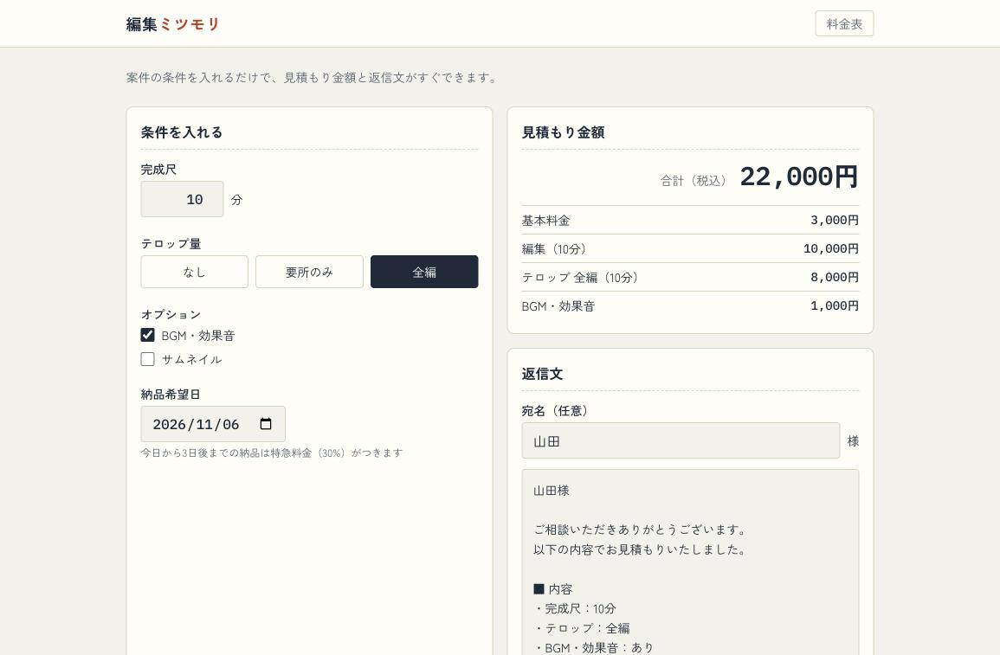
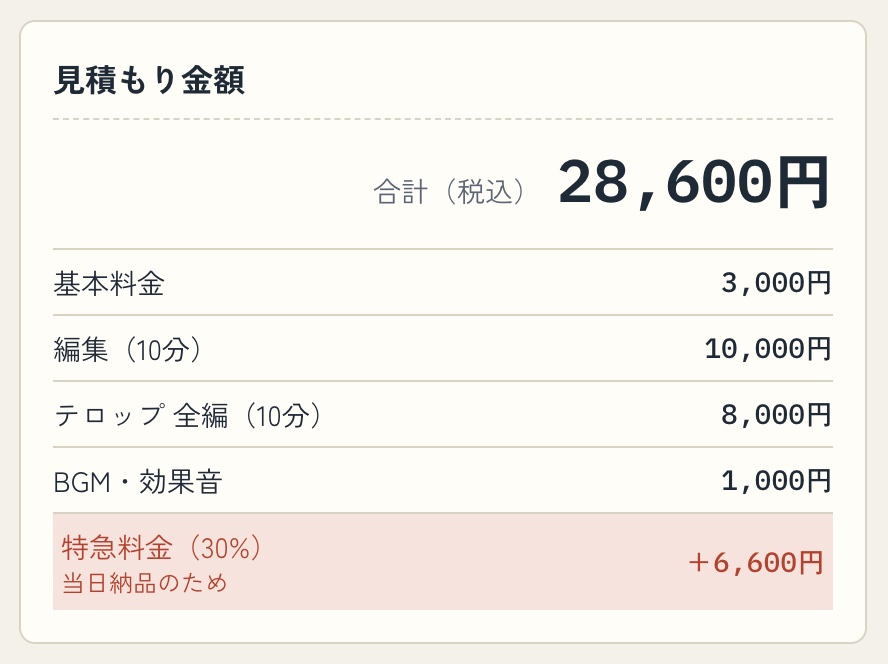
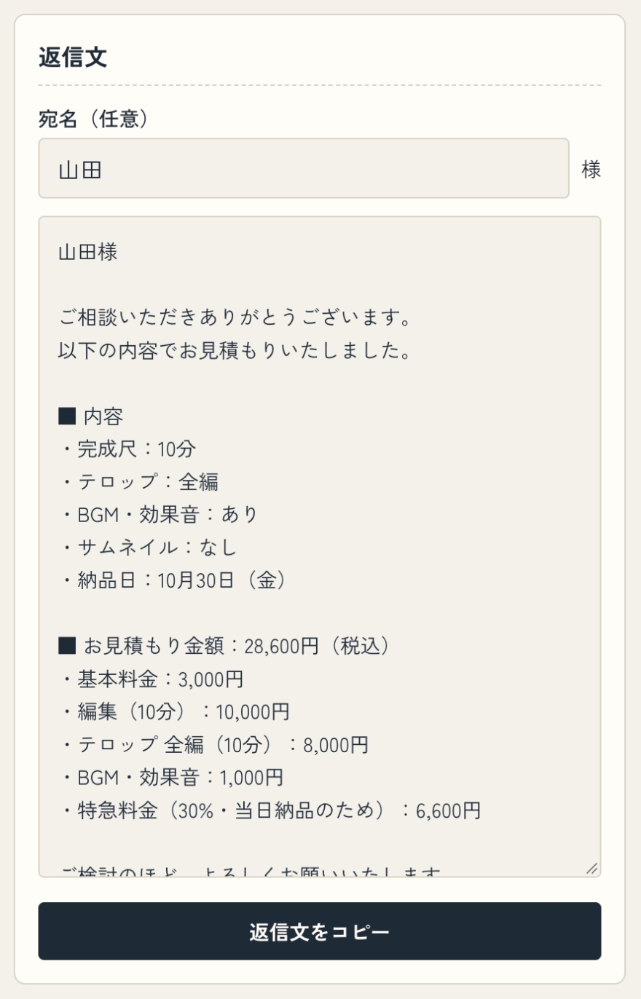
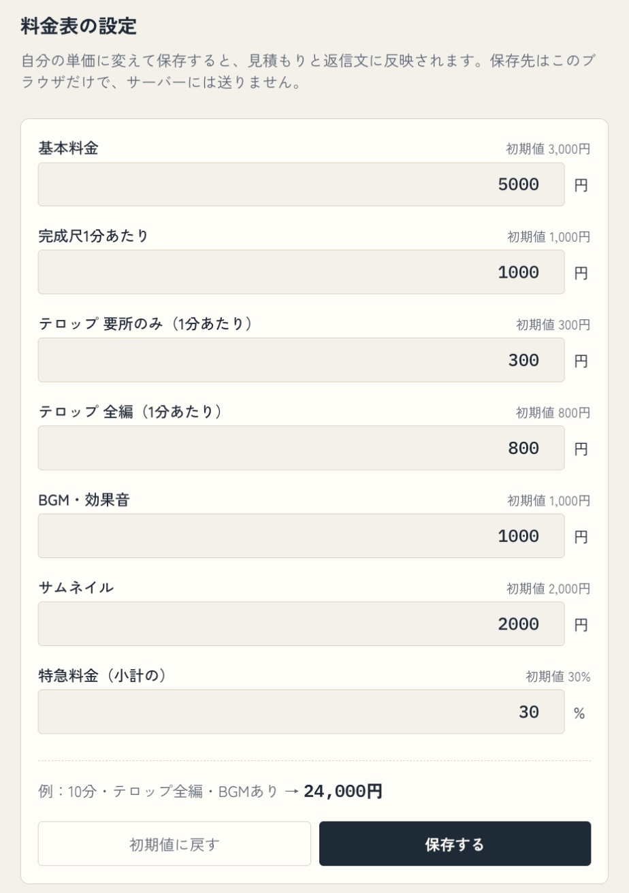
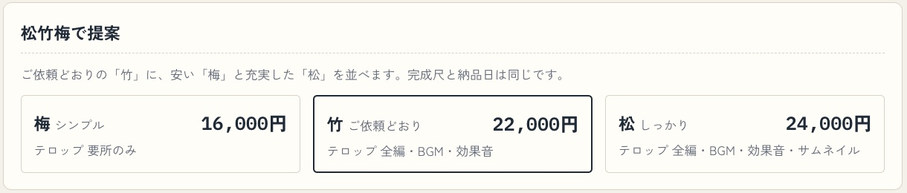
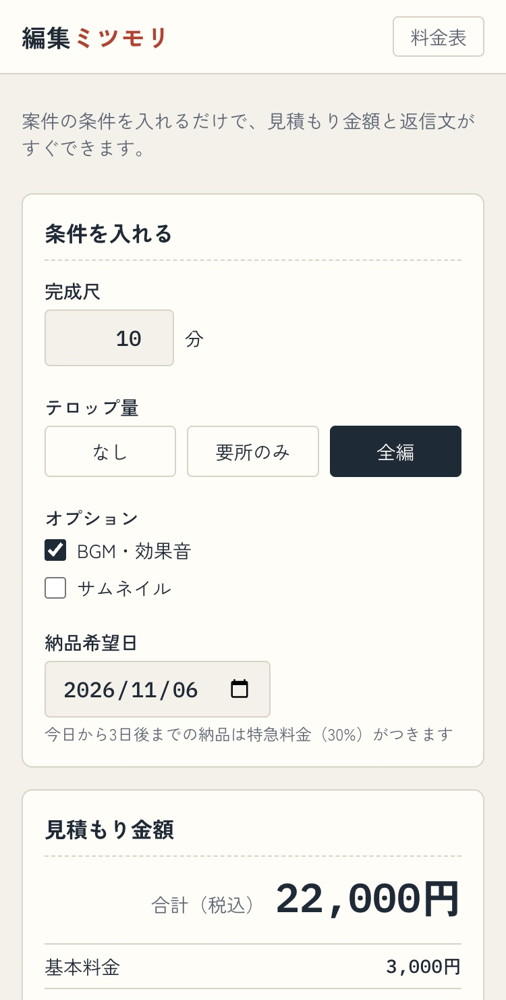

# 編集ミツモリ

**案件の条件を入れるだけで、見積もりと返信文がすぐできる。**
駆け出しの動画編集者が、完成尺・テロップ量・オプション・納期から見積もり金額を出し、クライアントへの返信文までそのまま作れるツールです。

- 公開URL: https://henshu-mitsumori.vercel.app
- GitHub: https://github.com/takagaku1117-ai/henshu-mitsumori
- 要件定義書: [requirements.md](requirements.md)



## 誰のため？

クラウドソーシングや SNS で YouTube などの編集案件を受けはじめた、**駆け出しの動画編集者**のためのツールです。

相談が来るたびに金額をその場で考えていると、毎回の金額がぶれたり、テロップやサムネイルの追加料金を入れ忘れて安く受けてしまったりします。返信文を毎回ゼロから書くのにも時間がかかります。

編集ミツモリは **「自分の料金表で計算する → 内訳つきの金額を見る → 返信文をコピーする」** までを1画面で終わらせます。

## できること

| 画面                                      | できること                                                                                                                              |
| ----------------------------------------- | --------------------------------------------------------------------------------------------------------------------------------------- |
|    | **見積もり金額**：入力を変えるとすぐに合計と内訳が変わる。納品まで3日以内なら特急料金と、その理由を表示                                 |
|           | **返信文**：宛名を入れると、内容・金額・内訳・納品日（11月6日（金）の形）を入れた返信文ができ、ボタン1つでコピー                        |
|  | **料金表の設定**：自分の単価に変えて保存。変えた結果の金額がその場で分かる。初期値にも戻せる                                            |
|     | **松竹梅で提案**（発展アイデア①）：依頼どおりの「竹」に、安い「梅」と充実した「松」を金額つきで並べる。チェックを入れると返信文にも載る |
|      | **スマホ対応**：幅 375px でも崩れない                                                                                                   |

| ID   | 機能                                                                                  |
| ---- | ------------------------------------------------------------------------------------- |
| F-01 | 見積もり条件の入力（完成尺 1〜60分・テロップ量・BGM・効果音・サムネイル・納品希望日） |
| F-02 | 合計金額と内訳の表示。納品まで3日以内は特急料金を加算し、理由を表示                   |
| F-03 | 返信文の作成とコピー（宛名は任意）                                                    |
| F-04 | 料金表の編集・ブラウザへの保存・初期値に戻す                                          |
| F-05 | 松竹梅の3パターン比較（発展アイデア①）。中身が竹と同じプランは出さない                |

## 料金の計算ルール

| 項目                 | 初期値          |
| -------------------- | --------------- |
| 基本料金             | 3,000円         |
| 完成尺1分あたり      | 1,000円         |
| テロップ（要所のみ） | 1分あたり 300円 |
| テロップ（全編）     | 1分あたり 800円 |
| BGM・効果音          | 1,000円         |
| サムネイル           | 2,000円         |
| 特急料金             | 小計の 30%      |

- **特急**：納品希望日が今日〜3日後（当日も3日後も含む）なら特急。4日後からは通常料金。
- **切り上げ**：合計は100円単位で切り上げる（例：4,300円 × 1.3 = 5,590円 → 5,600円）。お金の計算は小数を使わず整数だけで行う。
- **例**：10分・テロップ全編・BGMあり・納期に余裕あり → 3,000 + 10,000 + 8,000 + 1,000 = **22,000円**

## データの扱い

- ログインはありません。料金表は **使っているブラウザ（localStorage）にだけ** 保存し、サーバーには送りません。別のブラウザや端末では、それぞれ料金表を設定します。
- 宛名（クライアント名）はどこにも保存しません。
- 保存した料金表が壊れていても止まらないよう、読めない項目だけ初期値に戻して計算し、画面で知らせます。

## 技術構成

- Next.js 16（App Router・TypeScript）+ Tailwind CSS v4
- Vercel（GitHub に push すると自動でデプロイ）
- テスト：node:test（`tests/*.test.mjs`）。見積もりの計算・返信文・料金表の読み込みを画面から切り離してテスト

```
src/
├── app/
│   ├── page.tsx            見積もり画面
│   ├── estimator.tsx       入力フォーム・金額・返信文（クライアントコンポーネント）
│   ├── settings/           料金表の設定画面
│   └── not-found.tsx       404ページ
└── lib/
    ├── estimate.ts         見積もりの計算・特急の判定・入力チェック
    ├── reply.ts            返信文の作成・日付の書き方
    ├── plans.ts            松竹梅のプランの組み立て
    ├── prices.ts           料金表の初期値・保存値の読み込み
    └── use-prices.ts       料金表をブラウザに保存・読み込みするフック
```

## ローカルで動かす

```bash
npm install
npm run dev     # http://localhost:3000
npm test        # 計算・返信文・料金表・松竹梅のテスト
npm run lint
npm run build
```

環境変数は必要ありません。
